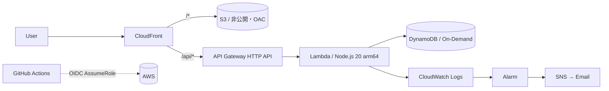

# Serverless Portfolio — AWS サーバーレス基盤 (Terraform + GitHub Actions)

> **公開 URL**: [https://xxxxxxxx.cloudfront.net](https://d2pztvu17968yn.cloudfront.net)  ← apply 後に差し替える
> **月額コスト実績**: 約 $0.xx（Cost Explorer のスクリーンショットを `docs/` に置く）

静的サイトと API を、すべて Terraform でコード化し、GitHub Actions から
OIDC 認証で自動デプロイするサーバーレス基盤です。

---

## 構成



| レイヤ | サービス | 選定理由 |
| --- | --- | --- |
| 配信 | CloudFront + S3(OAC) | S3 を非公開のまま配信できる。バケット公開は避ける |
| API | API Gateway HTTP API | REST API より安価・低レイテンシ。今回は認証機能が不要なため |
| 実行 | Lambda (arm64) | 常時起動が不要。Graviton で単価を下げる |
| DB | DynamoDB On-Demand | アクセスが読めないため。プロビジョンドは無駄が出る |
| CI/CD | GitHub Actions + OIDC | 長期アクセスキーを発行しない |

---

## 設計判断（意図的にこう選んだ点）

<!-- ここが一番読まれる。必ず自分の言葉で書くこと -->

1. **EC2 ではなくサーバーレスにした理由** —
2. **CORS 設定を書かずに CloudFront の `/api/*` ビヘイビアで解決した理由** —
3. **Lambda 実行ロールに `AmazonDynamoDBFullAccess` を使わなかった理由** —
4. **DynamoDB の PITR を無効にした理由（本番ならどうするか）** —
5. **CloudWatch Logs の保持期間を 7 日にした理由** —

## 却下した代替案

| 案 | 却下理由 |
| --- | --- |
| ALB + ECS Fargate | 常時起動で月 $30 以上。今回の要件（低頻度アクセス）に対して過剰 |
| S3 の静的ウェブサイトホスティング（バケット公開） | HTTPS が使えず、バケットを公開する必要がある |
| CI に長期アクセスキーを保存 | 漏洩リスク。OIDC で代替可能 |

---

## コスト試算（月額 / 東京リージョン）

| サービス | 想定量 | 概算 |
| --- | --- | --- |
| CloudFront | 1GB 転送・1万リクエスト | 無料枠内 |
| Lambda | 1万リクエスト・256MB | 無料枠内 |
| DynamoDB | オンデマンド 1万 RU/WU | 無料枠内 |
| S3 | 10MB・数千 GET | $0.01 未満 |
| CloudWatch Logs | 数十 MB（7 日保持） | $0.01 未満 |

<!-- 実際の Cost Explorer のスクショを docs/cost.png に置いて貼ること -->

---

## セットアップ手順

### 1. 前提
- Terraform >= 1.10
- AWS CLI（`aws configure` 済み、または SSO ログイン済み）

### 2. 初回 apply（ローカル）

```bash
cd terraform
cp terraform.tfvars.example terraform.tfvars   # 値を自分用に書き換える
terraform init
terraform plan
terraform apply
```

apply 後、`alert_email` 宛に SNS の購読確認メールが届くので承認する。

### 3. フロントエンドを配置

```bash
BUCKET=$(terraform output -raw s3_bucket)
aws s3 sync ../frontend "s3://${BUCKET}" --delete
terraform output -raw site_url
```

### 4. GitHub Actions を有効化

1. `terraform output -raw github_actions_role_arn` の値を控える
2. GitHub リポジトリ → Settings → Secrets and variables → Actions に登録
   - `AWS_ROLE_ARN` : 上記の値
   - `ALERT_EMAIL` : 通知先メールアドレス
3. main に push すると自動デプロイされる

### 5. （任意）tfstate を S3 に移す

state 用バケットを作成後、`terraform/versions.tf` の `backend "s3"` を有効化し
`terraform init -migrate-state` を実行する。

### 後片付け

```bash
terraform destroy
```

---

## つまずいた点と対処

<!-- ここを書くと一気に "実際にやった人" の文章になる。1つでもいいので必ず書く -->

- 例）CloudFront のデプロイ完了まで数分かかり、直後のアクセスで 403 が出た →
- 例）S3 バケット名がグローバル一意のため衝突した → アカウント ID をサフィックスに付けた

## 今後の改善案

- WAF によるレート制限の追加
- Cognito / Lambda Authorizer による認証
- tflint / trivy / Checkov を CI に追加
- 独自ドメイン + ACM 証明書
